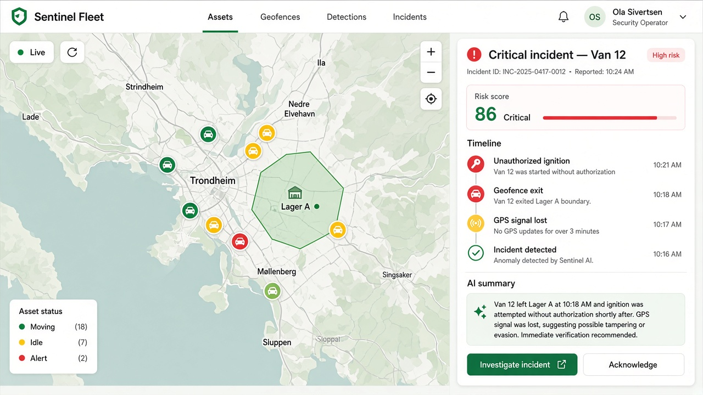

# Sentinel Fleet

  

**Sentinel Fleet** is a security and investigation platform for companies that manage vehicles, machinery, trailers, tools, and other mobile equipment.

Most GPS systems show where assets are. Sentinel Fleet answers what happened — and how serious it is.

---

## What it does

The platform watches live location and sensor data, then flags suspicious activity such as:

- Movement outside working hours  
- Geofence breaches  
- Unauthorized drivers  
- Sudden GPS signal loss  
- Abnormal fuel loss  
- Unusual driving patterns  
- Possible theft or misuse  

Related alerts are grouped into a single **incident**, so operators investigate one clear story instead of a flood of alarms.

---

## Built for investigation

When something looks wrong, Sentinel Fleet helps you reconstruct the event:

| | |
|---|---|
| **Live map** | See assets in real time, with status and geofences |
| **Incident playback** | Replay the route and what triggered the alert |
| **Timeline** | Follow the sequence of events step by step |
| **Risk score** | Understand severity and what drove the score |
| **AI analyst** | Get a grounded summary with references to the evidence |

---

## Who it’s for

Transport, construction, rental, logistics, industrial sites, municipal fleets — anyone responsible for costly mobile assets and the people who use them.

Typical users: fleet admins, security managers, analysts, and operators.

---

Detect · Correlate · Reconstruct

